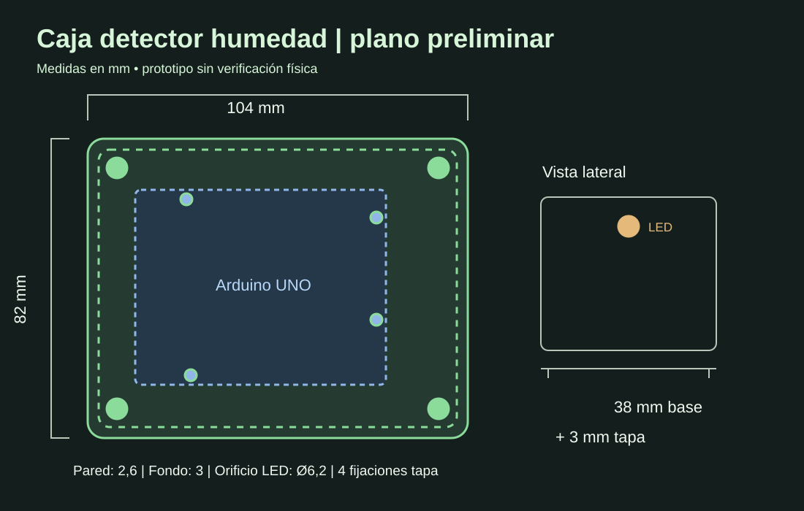

# Detector de humedad del suelo — Proyecto TEI201



Prototipo educativo basado en **Arduino UNO**, **sensor capacitivo de humedad del suelo v1.2** y **LED RGB (rojo, amarillo y verde)** para orientar el riego de una planta. Este repositorio documenta el diseño, la electrónica y una **caja impresa en 3D** con tapa desmontable. La sonda queda fuera de la caja para insertarse en la tierra.

> **Estado:** prototipo en desarrollo. El diseño 3D es preliminar; sus cotas deben contrastarse con la placa, conectores, LED, cableado y tornillos físicos. La carcasa no es impermeable.

## El problema y nuestra solución
El riego insuficiente o excesivo perjudica a las plantas. Nuestra propuesta mide la humedad del suelo y presenta una indicación visual para ayudar a decidir cuándo regar. El dispositivo **no calcula todavía cuánta agua aplicar** ni se ha cuantificado un ahorro de agua.

## Objetivos de Desarrollo Sostenible
- **ODS 11 · Ciudades y comunidades sostenibles:** facilita el cuidado de plantas en espacios urbanos.
- **ODS 12 · Producción y consumo responsables:** fomenta decisiones de riego basadas en la humedad del suelo.
- **ODS 15 · Vida de ecosistemas terrestres:** puede contribuir al cuidado de las plantas evitando condiciones de riego inadecuadas.

## Estructura (como el repositorio de referencia)
```text
├── hardware/
│   ├── bom/                 Componentes y costos pendientes
│   ├── esquemas/            Conexiones propuestas (por confirmar)
│   └── fotos/               Evidencias reales
├── software/
│   ├── src/                 Código real del equipo
│   ├── librerias/           Dependencias
│   └── docs/                Calibración y lógica del indicador
├── diseno_3d/
│   ├── fusion360/           CAD paramétrico OpenSCAD (no .f3d)
│   ├── planos/              Plano técnico esquemático en SVG
│   ├── renders/             Vista ilustrativa
│   └── stl/                 STL disponibles para ver e imprimir
├── testing/
│   ├── datos/               Plantilla para mediciones reales
│   ├── evidencias/
│   └── reportes/
├── documentacion/
│   ├── presentacion/
│   └── reporte_final/
└── iteraciones/
    ├── iteracion_1/
    ├── iteracion_2/
    └── iteracion_3/
```

## Modelo de caja 3D

**Dimensiones nominales externas:** 104 × 82 × 41 mm (base 38 mm, tapa 3 mm). Pared de 2,6 mm; piso de 3 mm.

Diseño en [`diseno_3d/fusion360/caja_sensor_humedad.scad`](diseno_3d/fusion360/caja_sensor_humedad.scad). Abrir en [OpenSCAD](https://openscad.org/), elegir `pieza = "base"` / `"tapa"`, pulsar **F6** y exportar STL. **Haz clic en los STL para verlos y girarlos directamente en GitHub**, sin buscar «Artifacts»: [base 3D](diseno_3d/stl/base_arduino_uno.stl) y [tapa 3D](diseno_3d/stl/tapa_led.stl). También hay un flujo de GitHub Actions que los regenera automáticamente.

- [Guía 3D y de impresión](diseno_3d/README.md).
- [Plano técnico](diseno_3d/planos/plano_caja.svg).
- [Modelos STL](diseno_3d/stl/) — se generan automáticamente cuando se ejecuta el flujo correspondiente.
- [Prueba de agujeros](diseno_3d/README.md) antes de imprimir la caja.

### Configuración de impresión inicial
Material PLA para uso interior o PETG para ambiente húmedo (sin impermeabilidad); capa 0,20 mm, boquilla 0,40 mm, tres perímetros, 15–25 % relleno. Algunas aberturas laterales requieren soportes. Comprobar tornillos y tolerancias.

## Código del Arduino (entregado por el equipo)

[**Abrir el código Arduino real**](software/src/detector_humedad.ino). Usa A0 para sensor y PWM 11/10/9 para LED RGB. Muestra **rojo** por debajo de 25 %, **amarillo** entre 25 y 44 %, **verde** desde 45 %. Los parámetros 895 y 767 requieren calibración con la sonda.

## Documentación y validaciones pendientes
- Validar dimensiones exactas del Arduino UNO **de la fotografía** y su patrón de montaje.
- Medir diámetro y placa del módulo LED y altura de conectores Dupont.
- Confirmar conexiones reales y umbral después de calibrar la sonda seca/húmeda.
- Registrar mediciones reales y pruebas con usuarios sin inventar resultados.
- Completar el ensamblaje CAD con todos los componentes y exportar a Fusion 360 si el curso requiere un archivo nativo `.f3d`.

## Referencia
Estructura inspirada en el repositorio público de TEI201 de [sebasdv/proyecto_final_TEI201](https://github.com/sebasdv/proyecto_final_TEI201). Contenidos de este proyecto y su diseño de caja adaptados al detector de humedad.

**Nota:** este repositorio describe un prototipo preliminar, no un producto eléctrico certificado ni una caja para exterior.
