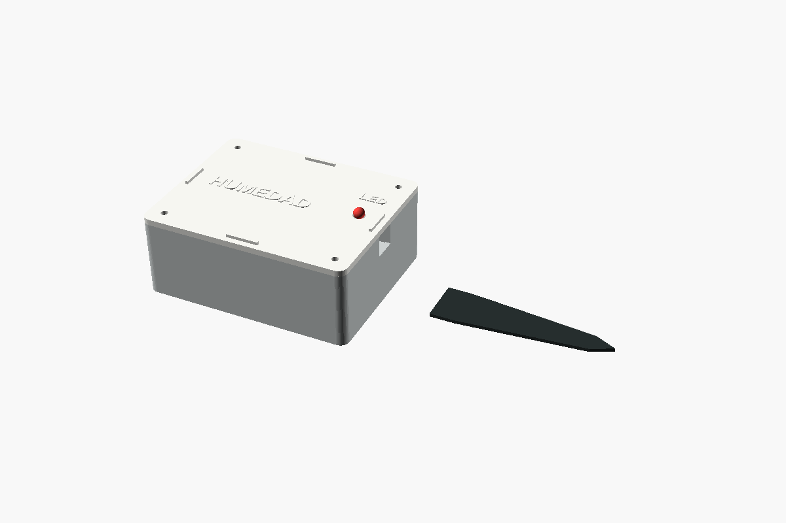
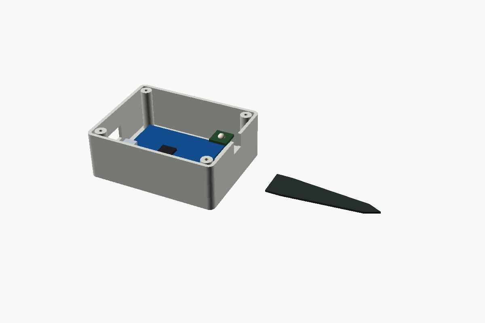
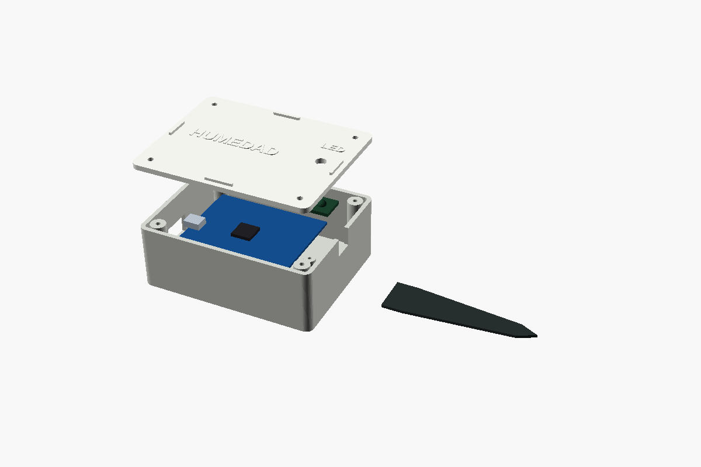
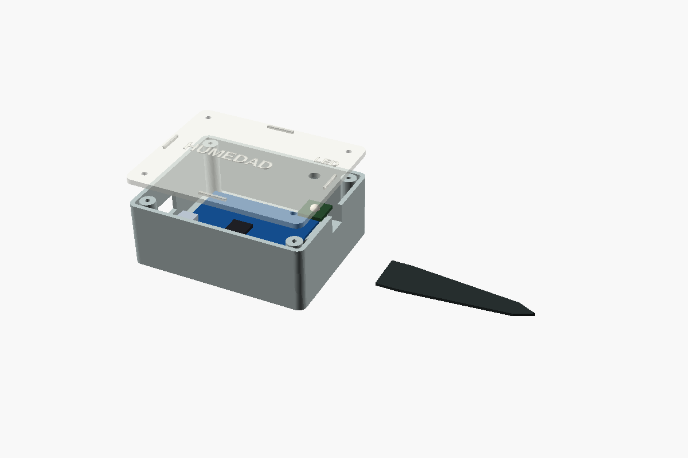

# Renders del diseño

Creamos distintas vistas del modelo 3D de nuestro detector:

### Exterior

### Interior

### Vista explosionada

### Vista general

Estas imágenes corresponden a nuestro diseño digital; las [fotografías](../../hardware/fotos/README.md) muestran el montaje físico.
