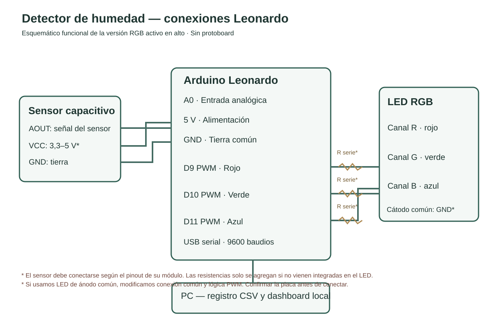

# Esquema y conexiones

Utilizamos un Arduino Leonardo, un sensor capacitivo y un LED RGB. Conectamos el sensor a A0 y los canales de color a D9 (rojo), D10 (verde) y D11 (azul). Eliminamos la protoboard para reducir el volumen del montaje.

En el [esquema detallado](esquematico_detallado.svg) mostramos la alimentación del sensor, la lectura analógica, el control de los tres colores y la conexión USB para registrar datos. Las resistencias en serie corresponden a un LED RGB sin limitadores integrados; si nuestro módulo ya los incorpora no duplicamos estas resistencias. El programa actual supone un indicador activo en alto, por lo que verificamos el tipo de LED y su pinout.

También conservamos el [diagrama general del sistema](esquema_leonardo.svg).
