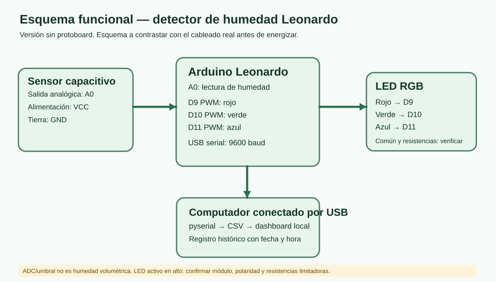

# Esquema de conexiones

Montamos el sistema con un Arduino Leonardo, un sensor capacitivo y un LED RGB de tres canales. El sensor está conectado a la entrada **A0** y las salidas PWM controlan los colores del indicador.

| Cable / señal | Origen | Destino |
|---|---|---|
| Señal analógica | AOUT del sensor | A0 del Leonardo |
| Alimentación | VCC del módulo sensor | Salida compatible de alimentación |
| Tierra | GND del sensor | GND del Leonardo |
| Canal rojo | D9 | Canal R del módulo RGB |
| Canal verde | D10 | Canal G del módulo RGB |
| Canal azul | D11 | Canal B del módulo RGB |
| Común RGB | Común del LED | Tierra o alimentación, según el modelo |
| Datos y alimentación | USB del Leonardo | Computador |

Para evitar dañar el LED, tenemos que utilizar resistencias limitadoras si el módulo no las tiene integradas. Si el LED es de ánodo común, también es necesario invertir la lógica de intensidad del programa.

El cableado es directo, sin protoboard. El esquema describe la asignación de señales de nuestro programa. La posición exacta de los terminales se comprueba con la serigrafía del módulo, porque no es seguro deducirla por los colores de los cables.

[Diagrama general del sistema](esquema_leonardo.svg) · [Componentes utilizados](../bom/README.md)
